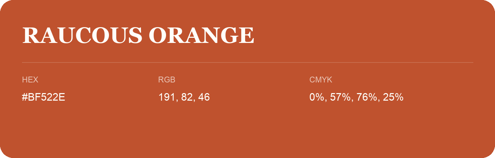

## Raucous Orange

- HEX: #BF522E
- RGB: 191, 82, 46
- CMYK: 0%, 57%, 76%, 25%
- Character: warm, expressive, energetic
- Suggested uses: food brands, expressive identities, promotional accents

- Source images: iCloud Photos 2/IMG_9153.JPG
