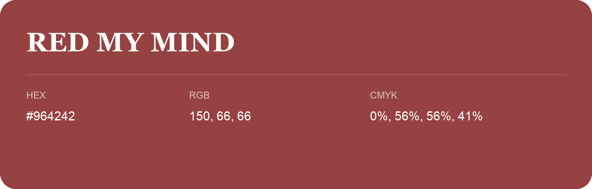

## Red My Mind

- HEX: #964242
- RGB: 150, 66, 66
- CMYK: 0%, 56%, 56%, 41%
- Character: warm, expressive, energetic
- Suggested uses: food brands, expressive identities, promotional accents

- Source images: IMG_9063.JPG
