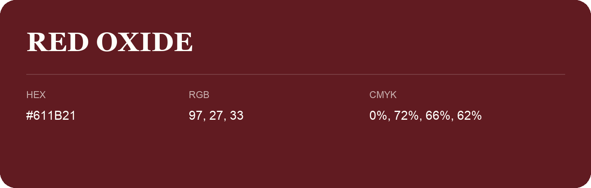

## Red Oxide

- HEX: #611B21
- RGB: 97, 27, 33
- CMYK: 0%, 72%, 66%, 62%
- Character: deep, grounded, understated
- Suggested uses: premium packaging, editorial typography, dark backgrounds

- Source images: iCloud Photos 2/IMG_9152.JPG
