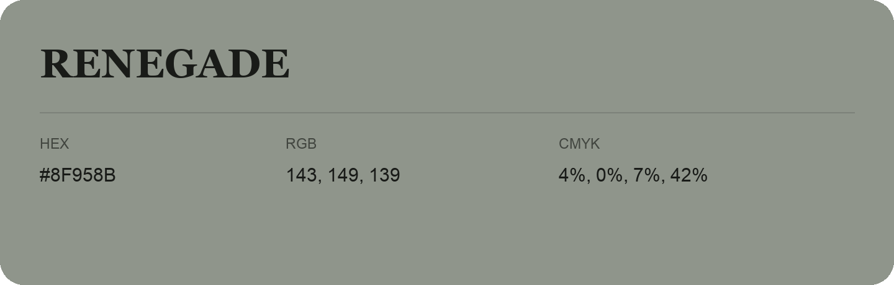

## Renegade

- HEX: #8F958B
- RGB: 143, 149, 139
- CMYK: 4%, 0%, 7%, 42%
- Character: quiet, balanced, understated
- Suggested uses: professional services, minimal identities, supporting backgrounds

- Source images: IMG_9083.JPG
