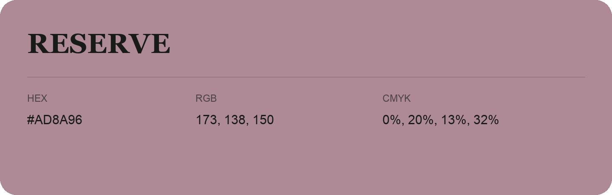

## Reserve

- HEX: #AD8A96
- RGB: 173, 138, 150
- CMYK: 0%, 20%, 13%, 32%
- Character: expressive, imaginative, refined
- Suggested uses: beauty brands, creative businesses, distinctive accents

- Source images: IMG_9006.JPG

## Consolidated source variants

This is the canonical library entry. Same-name variants below are within ΔE00 ≤ 1 of this shade and were consolidated editorially. Their source values are preserved; they were not source errors.

### Source variant #AE8B98

- HEX: #AE8B98
- RGB: 174, 139, 152
- CMYK: 0%, 20%, 13%, 32%
- Difference from canonical: ΔE00 0.5160.
- Source images: IMG_9096.JPG
