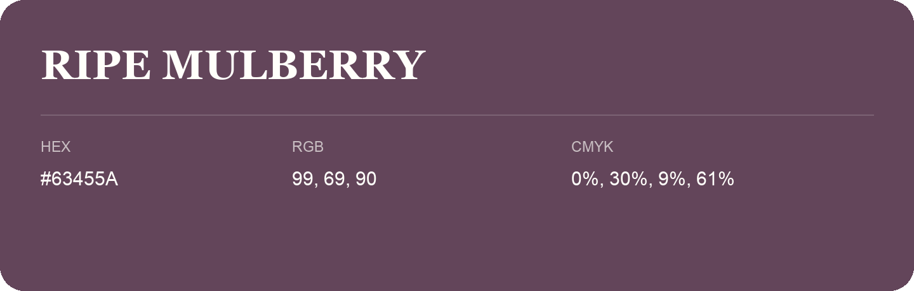

## Ripe Mulberry

- HEX: #63455A
- RGB: 99, 69, 90
- CMYK: 0%, 30%, 9%, 61%
- Character: deep, grounded, understated
- Suggested uses: premium packaging, editorial typography, dark backgrounds

- Source images: iCloud Photos 2/IMG_9145.JPG
