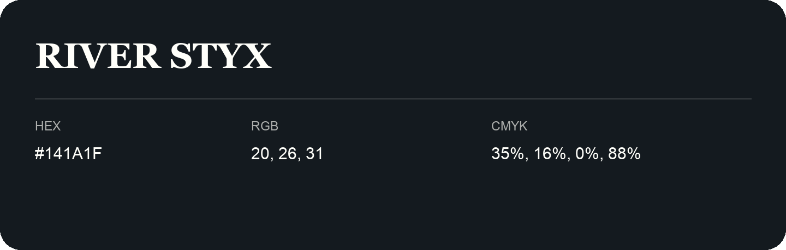

## River Styx

- HEX: #141A1F
- RGB: 20, 26, 31
- CMYK: 35%, 16%, 0%, 88%
- Character: cool, composed, dependable
- Suggested uses: professional services, technology brands, calm backgrounds

- Source images: IMG_9100.JPG
