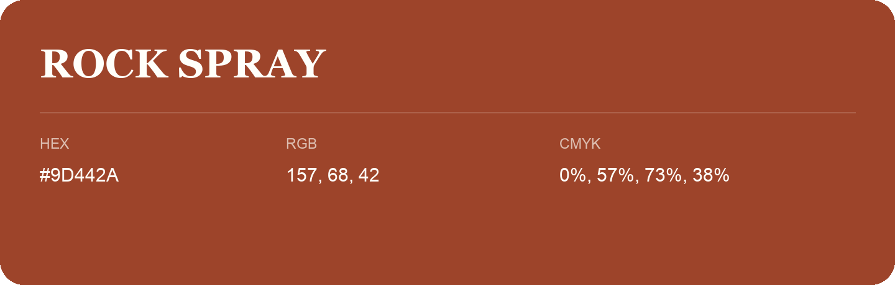

## Rock Spray

- HEX: #9D442A
- RGB: 157, 68, 42
- CMYK: 0%, 57%, 73%, 38%
- Character: warm, expressive, energetic
- Suggested uses: food brands, expressive identities, promotional accents

- Source images: IMG_9068.JPG
