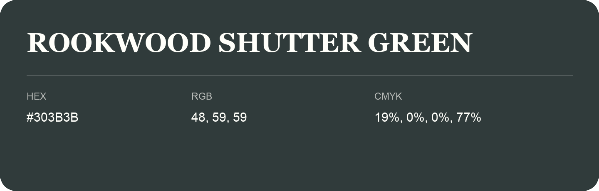

## Rookwood Shutter Green

- HEX: #303B3B
- RGB: 48, 59, 59
- CMYK: 19%, 0%, 0%, 77%
- Character: calm, fresh, composed
- Suggested uses: wellness brands, coastal hospitality, modern service brands

- Source images: IMG_9100.JPG

- Data provenance: HEX recovered from page data; cross-checked against the readable source RGB.
