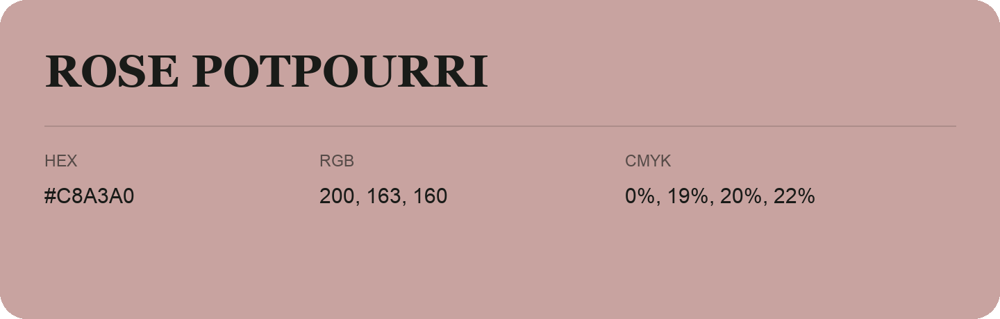

## Rose Potpourri

- HEX: #C8A3A0
- RGB: 200, 163, 160
- CMYK: 0%, 19%, 20%, 22%
- Character: soft, warm, playful
- Suggested uses: friendly consumer brands, gentle backgrounds, welcoming accents

- Source images: iCloud Photos 2/IMG_9183.JPG
