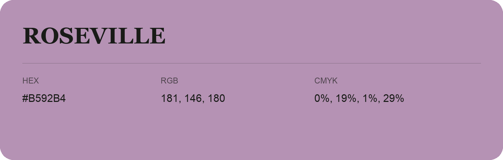

## Roseville

- HEX: #B592B4
- RGB: 181, 146, 180
- CMYK: 0%, 19%, 1%, 29%
- Character: expressive, imaginative, refined
- Suggested uses: beauty brands, creative businesses, distinctive accents

- Source images: iCloud Photos 2/IMG_9171.JPG
