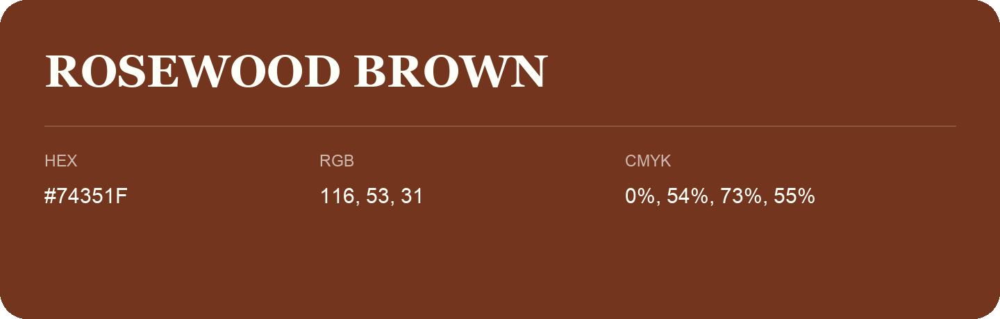

## Rosewood Brown

- HEX: #74351F
- RGB: 116, 53, 31
- CMYK: 0%, 54%, 73%, 55%
- Character: earthy, rich, warm
- Suggested uses: premium packaging, rustic brands, dark backgrounds

- Source images: iCloud Photos 2/IMG_9149.JPG
