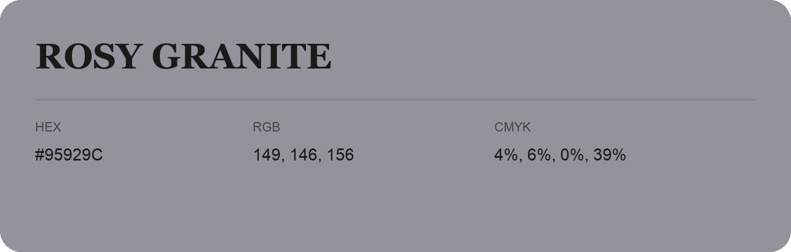

## Rosy Granite

- HEX: #95929C
- RGB: 149, 146, 156
- CMYK: 4%, 6%, 0%, 39%
- Character: quiet, balanced, understated
- Suggested uses: professional services, minimal identities, supporting backgrounds

- Source images: IMG_8992.JPG
