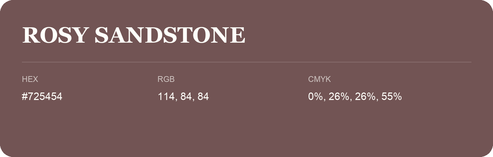

## Rosy Sandstone

- HEX: #725454
- RGB: 114, 84, 84
- CMYK: 0%, 26%, 26%, 55%
- Character: warm, expressive, energetic
- Suggested uses: food brands, expressive identities, promotional accents

- Source images: IMG_9093.JPG
