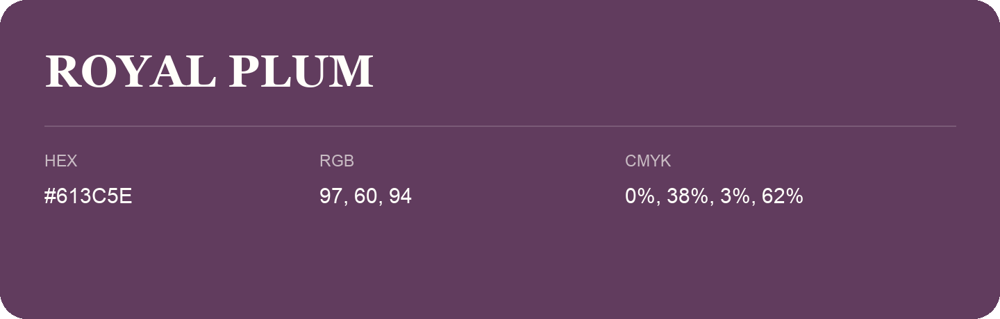

## Royal Plum

- HEX: #613C5E
- RGB: 97, 60, 94
- CMYK: 0%, 38%, 3%, 62%
- Character: expressive, imaginative, refined
- Suggested uses: beauty brands, creative businesses, distinctive accents

- Source images: IMG_9012.JPG
