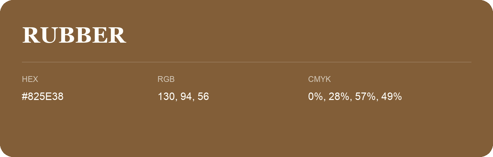

## Rubber

- HEX: #825E38
- RGB: 130, 94, 56
- CMYK: 0%, 28%, 57%, 49%
- Character: earthy, rich, warm
- Suggested uses: premium packaging, rustic brands, dark backgrounds

- Source images: IMG_9049.JPG
