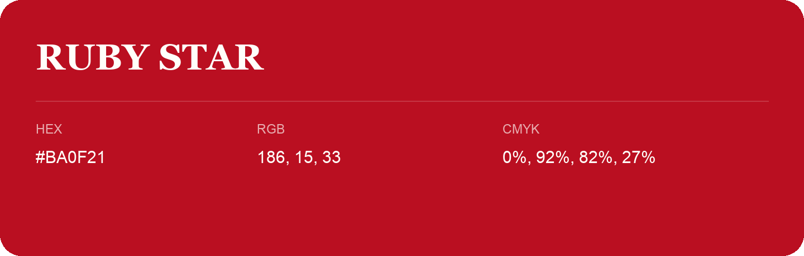

## Ruby Star

- HEX: #BA0F21
- RGB: 186, 15, 33
- CMYK: 0%, 92%, 82%, 27%
- Character: warm, expressive, energetic
- Suggested uses: food brands, expressive identities, promotional accents

- Source images: IMG_9032.JPG

- Data provenance: HEX recovered from page data; cross-checked against the readable source RGB.
