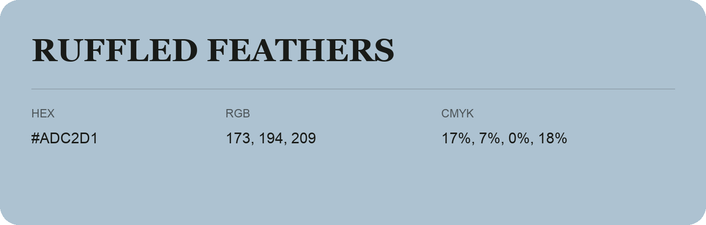

## Ruffled Feathers

- HEX: #ADC2D1
- RGB: 173, 194, 209
- CMYK: 17%, 7%, 0%, 18%
- Character: soft, gentle, approachable
- Suggested uses: friendly consumer brands, gentle backgrounds, welcoming accents

- Source images: IMG_9028.JPG
