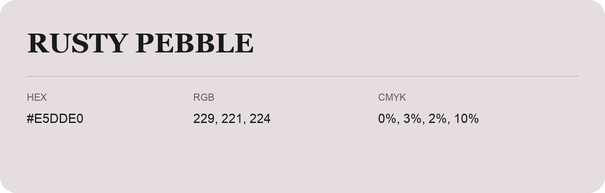

## Rusty Pebble

- HEX: #E5DDE0
- RGB: 229, 221, 224
- CMYK: 0%, 3%, 2%, 10%
- Character: quiet, balanced, understated
- Suggested uses: professional services, minimal identities, supporting backgrounds

- Source images: IMG_9118.JPG

- Data provenance: HEX recovered from page data; cross-checked against the recognized source text with visually equivalent glyphs.
- Data provenance: RGB calculated from HEX, matching the page; source image RGB was unreadable.
