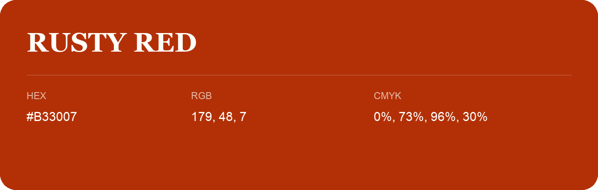

## Rusty Red

- HEX: #B33007
- RGB: 179, 48, 7
- CMYK: 0%, 73%, 96%, 30%
- Character: warm, expressive, energetic
- Suggested uses: food brands, expressive identities, promotional accents

- Source images: iCloud Photos 2/IMG_9180.JPG

- Name note: Other distinct shades share this name: [rusty-red](rusty-red.md).
