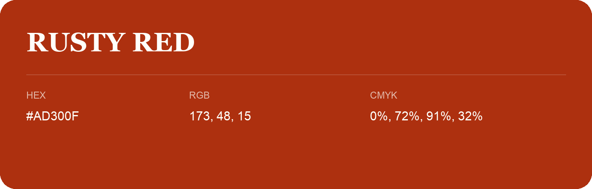

## Rusty Red

- HEX: #AD300F
- RGB: 173, 48, 15
- CMYK: 0%, 72%, 91%, 32%
- Character: warm, expressive, energetic
- Suggested uses: food brands, expressive identities, promotional accents

- Source images: IMG_9064.JPG

- Name note: Other distinct shades share this name: [rusty-red-b33007](rusty-red-b33007.md).
