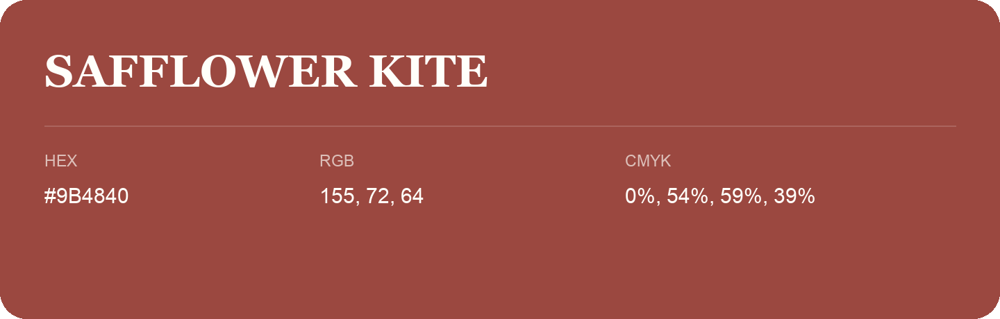

## Safflower Kite

- HEX: #9B4840
- RGB: 155, 72, 64
- CMYK: 0%, 54%, 59%, 39%
- Character: warm, expressive, energetic
- Suggested uses: food brands, expressive identities, promotional accents

- Source images: IMG_9089.JPG
