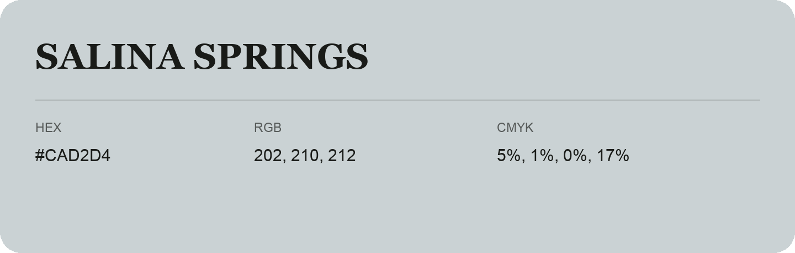

## Salina Springs

- HEX: #CAD2D4
- RGB: 202, 210, 212
- CMYK: 5%, 1%, 0%, 17%
- Character: quiet, balanced, understated
- Suggested uses: professional services, minimal identities, supporting backgrounds

- Source images: IMG_8979.JPG
