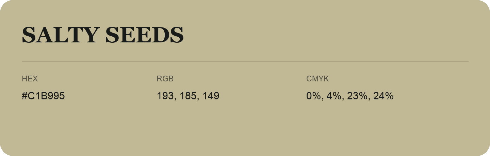

## Salty Seeds

- HEX: #C1B995
- RGB: 193, 185, 149
- CMYK: 0%, 4%, 23%, 24%
- Character: soft, gentle, approachable
- Suggested uses: friendly consumer brands, gentle backgrounds, welcoming accents

- Source images: iCloud Photos 2/IMG_9147.JPG
