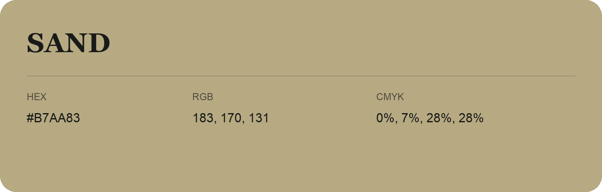

## Sand

- HEX: #B7AA83
- RGB: 183, 170, 131
- CMYK: 0%, 7%, 28%, 28%
- Character: earthy, rich, warm
- Suggested uses: artisan businesses, hospitality brands, warm accents

- Source images: IMG_8984.JPG
