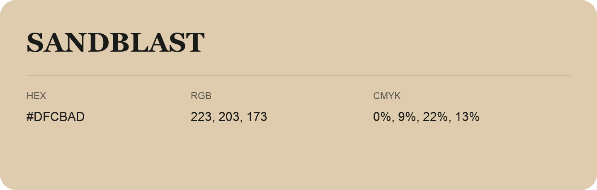

## Sandblast

- HEX: #DFCBAD
- RGB: 223, 203, 173
- CMYK: 0%, 9%, 22%, 13%
- Character: soft, gentle, approachable
- Suggested uses: friendly consumer brands, gentle backgrounds, welcoming accents

- Source images: iCloud Photos 2/IMG_9177.JPG
