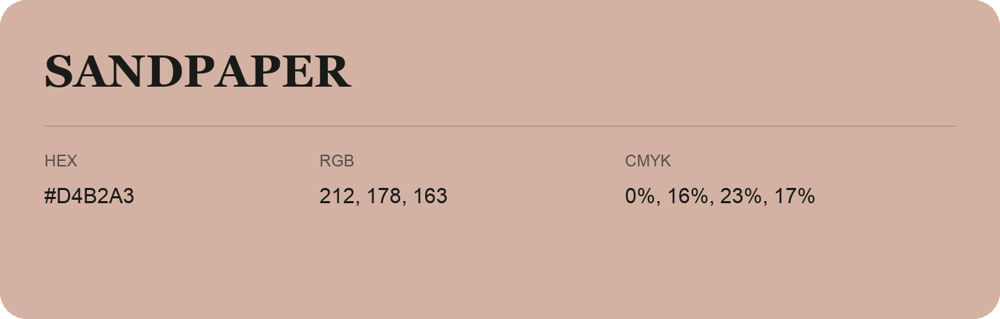

## Sandpaper

- HEX: #D4B2A3
- RGB: 212, 178, 163
- CMYK: 0%, 16%, 23%, 17%
- Character: soft, warm, playful
- Suggested uses: friendly consumer brands, gentle backgrounds, welcoming accents

- Source images: IMG_9104.JPG
