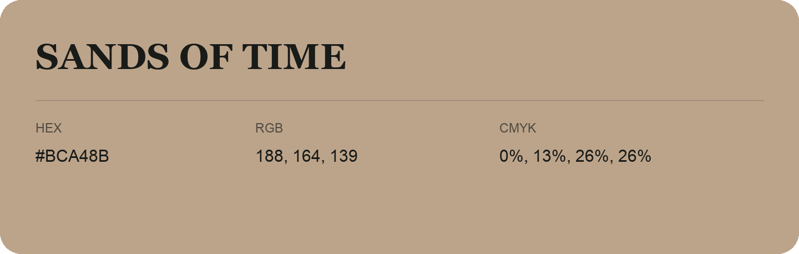

## Sands Of Time

- HEX: #BCA48B
- RGB: 188, 164, 139
- CMYK: 0%, 13%, 26%, 26%
- Character: earthy, rich, warm
- Suggested uses: artisan businesses, hospitality brands, warm accents

- Source images: IMG_9072.JPG

- Data provenance: RGB calculated from HEX, matching the page; source image RGB was unreadable.
