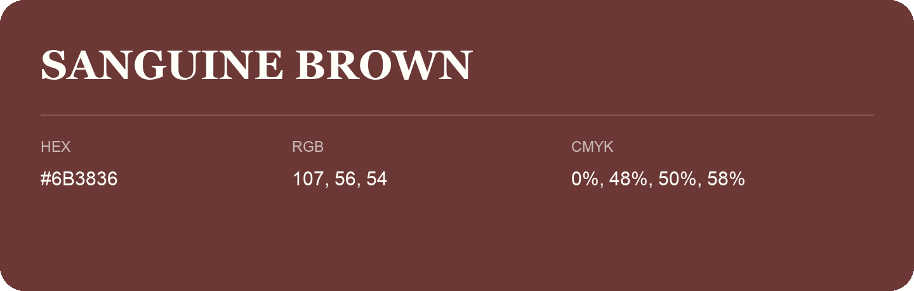

## Sanguine Brown

- HEX: #6B3836
- RGB: 107, 56, 54
- CMYK: 0%, 48%, 50%, 58%
- Character: warm, expressive, energetic
- Suggested uses: food brands, expressive identities, promotional accents

- Source images: iCloud Photos 2/IMG_9140.JPG
