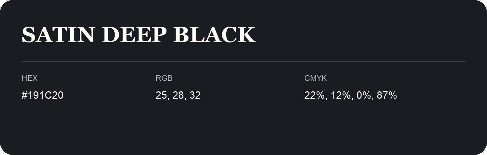

## Satin Deep Black

- HEX: #191C20
- RGB: 25, 28, 32
- CMYK: 22%, 12%, 0%, 87%
- Character: cool, composed, dependable
- Suggested uses: professional services, technology brands, calm backgrounds

- Source images: IMG_9048.JPG
