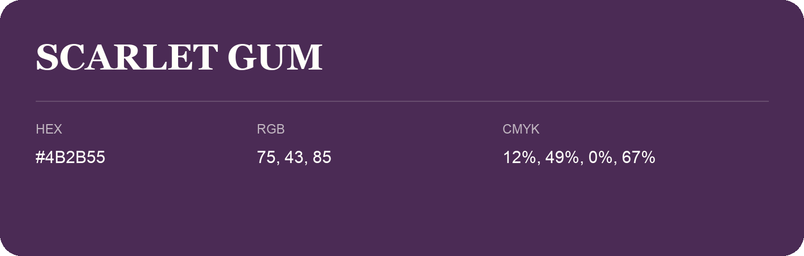

## Scarlet Gum

- HEX: #4B2B55
- RGB: 75, 43, 85
- CMYK: 12%, 49%, 0%, 67%
- Character: deep, grounded, understated
- Suggested uses: premium packaging, editorial typography, dark backgrounds

- Source images: iCloud Photos 2/IMG_9148.JPG
