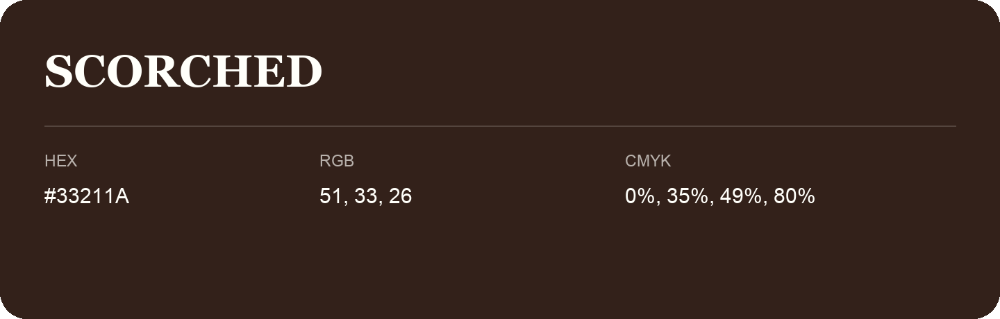

## Scorched

- HEX: #33211A
- RGB: 51, 33, 26
- CMYK: 0%, 35%, 49%, 80%
- Character: deep, grounded, understated
- Suggested uses: premium packaging, editorial typography, dark backgrounds

- Source images: IMG_9089.JPG

- Name note: Other distinct shades share this name: [scorched-352118](scorched-352118.md).
