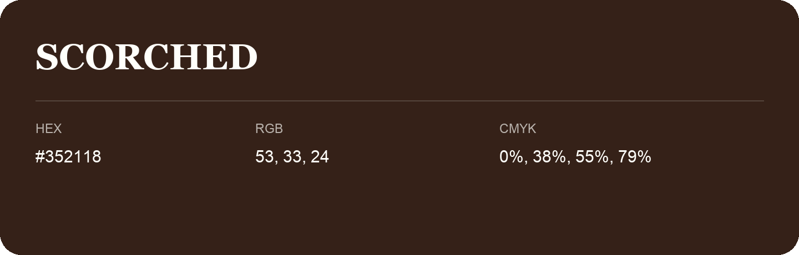

## Scorched

- HEX: #352118
- RGB: 53, 33, 24
- CMYK: 0%, 38%, 55%, 79%
- Character: deep, grounded, understated
- Suggested uses: premium packaging, editorial typography, dark backgrounds

- Source images: IMG_9058.JPG

- Name note: Other distinct shades share this name: [scorched-33211a](scorched-33211a.md).
