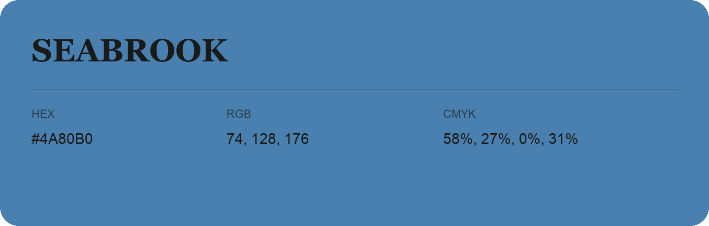

## Seabrook

- HEX: #4A80B0
- RGB: 74, 128, 176
- CMYK: 58%, 27%, 0%, 31%
- Character: cool, composed, dependable
- Suggested uses: professional services, technology brands, calm backgrounds

- Source images: iCloud Photos 2/IMG_9129.JPG
