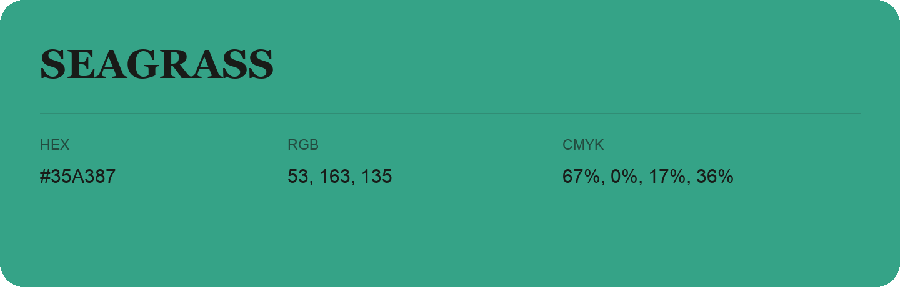

## Seagrass

- HEX: #35A387
- RGB: 53, 163, 135
- CMYK: 67%, 0%, 17%, 36%
- Character: natural, grounded, fresh
- Suggested uses: outdoor businesses, wellness brands, organic packaging

- Source images: IMG_8989.JPG
