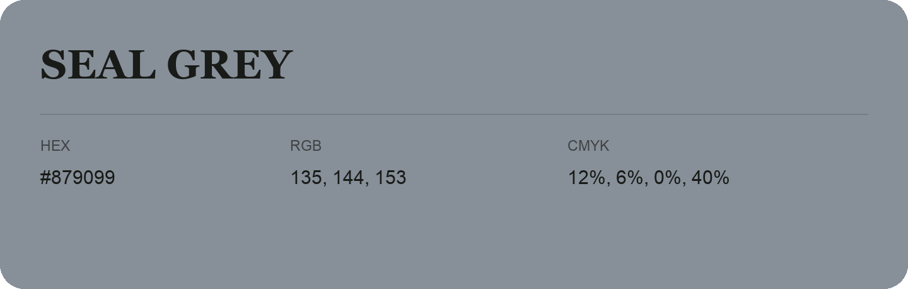

## Seal Grey

- HEX: #879099
- RGB: 135, 144, 153
- CMYK: 12%, 6%, 0%, 40%
- Character: quiet, balanced, understated
- Suggested uses: professional services, minimal identities, supporting backgrounds

- Source images: IMG_9022.JPG

- Data provenance: RGB calculated from HEX, matching the page; source image RGB was unreadable.
