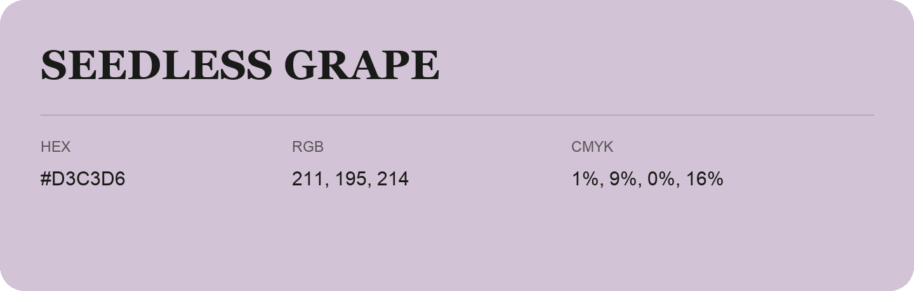

## Seedless Grape

- HEX: #D3C3D6
- RGB: 211, 195, 214
- CMYK: 1%, 9%, 0%, 16%
- Character: quiet, balanced, understated
- Suggested uses: professional services, minimal identities, supporting backgrounds

- Source images: IMG_9025.JPG
