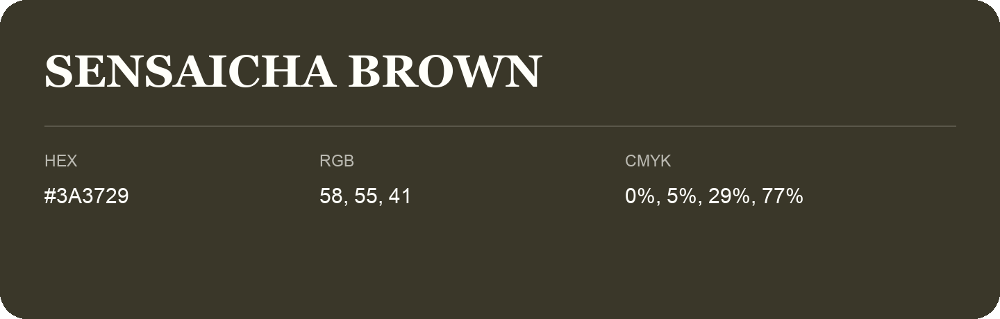

## Sensaicha Brown

- HEX: #3A3729
- RGB: 58, 55, 41
- CMYK: 0%, 5%, 29%, 77%
- Character: deep, grounded, understated
- Suggested uses: premium packaging, editorial typography, dark backgrounds

- Source images: iCloud Photos 2/IMG_9123.JPG
