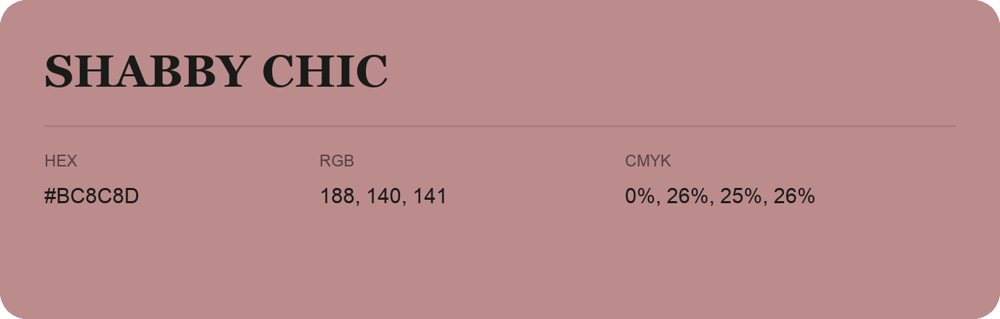

## Shabby Chic

- HEX: #BC8C8D
- RGB: 188, 140, 141
- CMYK: 0%, 26%, 25%, 26%
- Character: warm, expressive, energetic
- Suggested uses: food brands, expressive identities, promotional accents

- Source images: iCloud Photos 2/IMG_9146.JPG
