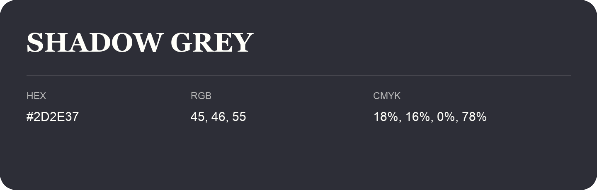

## Shadow Grey

- HEX: #2D2E37
- RGB: 45, 46, 55
- CMYK: 18%, 16%, 0%, 78%
- Character: cool, composed, dependable
- Suggested uses: professional services, technology brands, calm backgrounds

- Source images: IMG_8984.JPG
