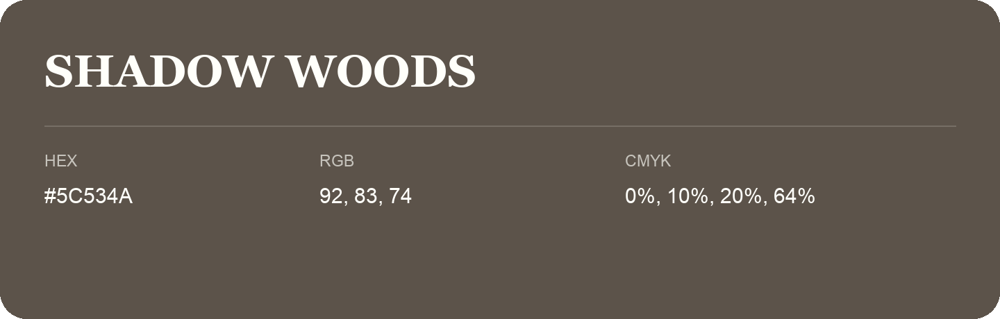

## Shadow Woods

- HEX: #5C534A
- RGB: 92, 83, 74
- CMYK: 0%, 10%, 20%, 64%
- Character: earthy, rich, warm
- Suggested uses: premium packaging, rustic brands, dark backgrounds

- Source images: IMG_9061.JPG
