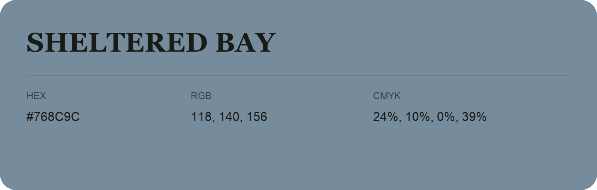

## Sheltered Bay

- HEX: #768C9C
- RGB: 118, 140, 156
- CMYK: 24%, 10%, 0%, 39%
- Character: cool, composed, dependable
- Suggested uses: professional services, technology brands, calm backgrounds

- Source images: IMG_9113.JPG
