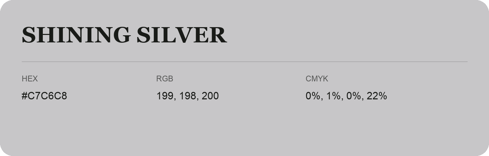

## Shining Silver

- HEX: #C7C6C8
- RGB: 199, 198, 200
- CMYK: 0%, 1%, 0%, 22%
- Character: quiet, balanced, understated
- Suggested uses: professional services, minimal identities, supporting backgrounds

- Source images: IMG_9026.JPG

- Data provenance: RGB calculated from HEX, matching the page; source image RGB was unreadable.
