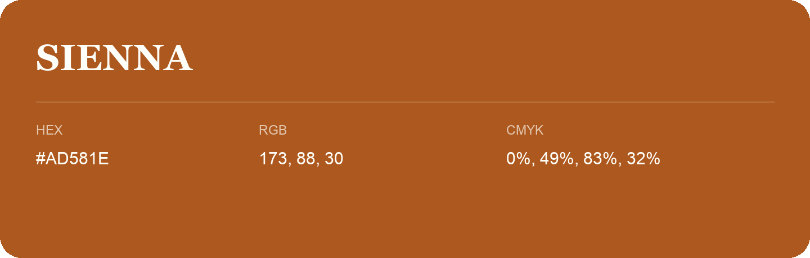

## Sienna

- HEX: #AD581E
- RGB: 173, 88, 30
- CMYK: 0%, 49%, 83%, 32%
- Character: earthy, rich, warm
- Suggested uses: artisan businesses, hospitality brands, warm accents

- Source images: iCloud Photos 2/IMG_9169.JPG
