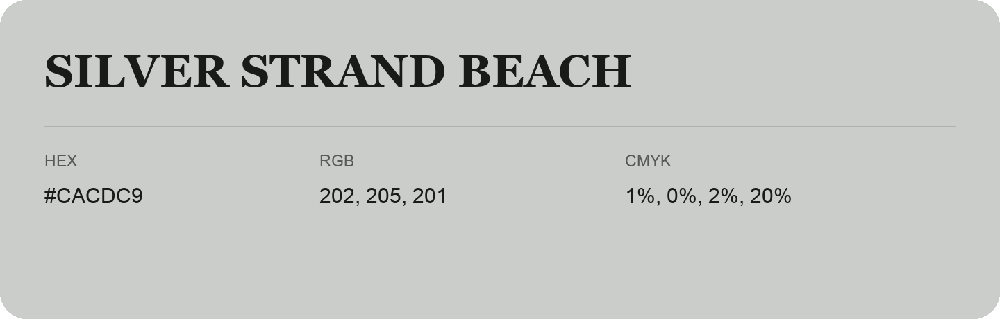

## Silver Strand Beach

- HEX: #CACDC9
- RGB: 202, 205, 201
- CMYK: 1%, 0%, 2%, 20%
- Character: quiet, balanced, understated
- Suggested uses: professional services, minimal identities, supporting backgrounds

- Source images: iCloud Photos 2/IMG_9165.JPG
