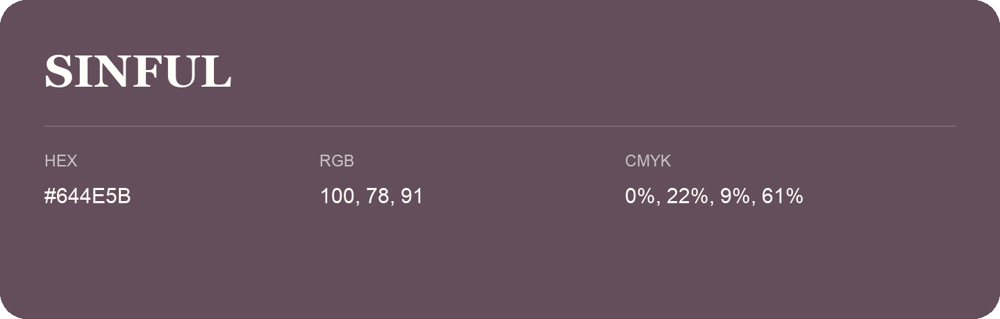

## Sinful

- HEX: #644E5B
- RGB: 100, 78, 91
- CMYK: 0%, 22%, 9%, 61%
- Character: expressive, imaginative, refined
- Suggested uses: beauty brands, creative businesses, distinctive accents

- Source images: iCloud Photos 2/IMG_9171.JPG
