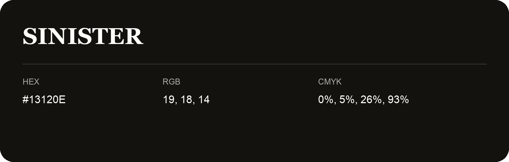

## Sinister

- HEX: #13120E
- RGB: 19, 18, 14
- CMYK: 0%, 5%, 26%, 93%
- Character: deep, grounded, understated
- Suggested uses: premium packaging, editorial typography, dark backgrounds

- Source images: iCloud Photos 2/IMG_9141.JPG
