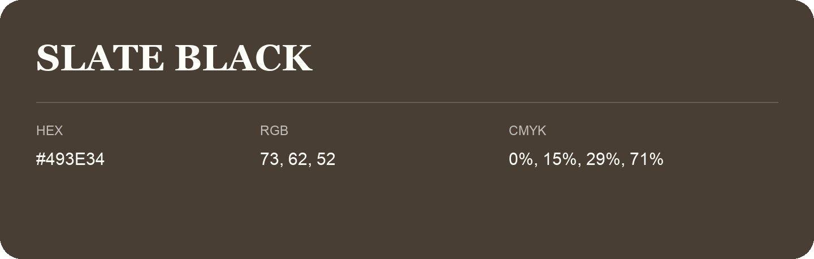

## Slate Black

- HEX: #493E34
- RGB: 73, 62, 52
- CMYK: 0%, 15%, 29%, 71%
- Character: earthy, rich, warm
- Suggested uses: premium packaging, rustic brands, dark backgrounds

- Source images: IMG_9001.JPG
