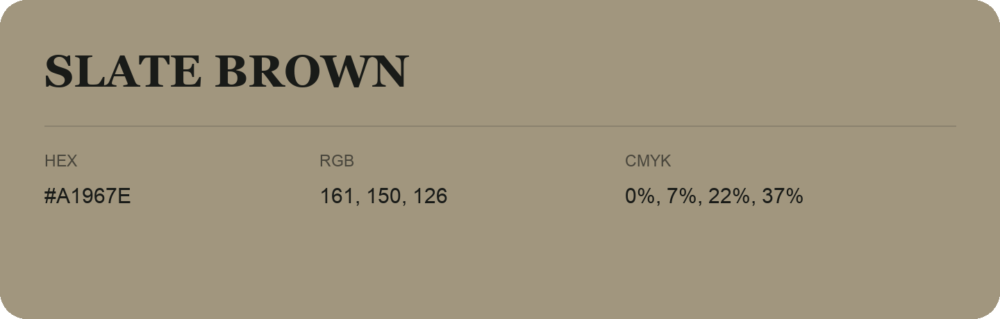

## Slate Brown

- HEX: #A1967E
- RGB: 161, 150, 126
- CMYK: 0%, 7%, 22%, 37%
- Character: earthy, rich, warm
- Suggested uses: artisan businesses, hospitality brands, warm accents

- Source images: IMG_9017.JPG
