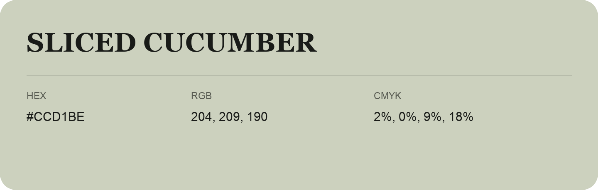

## Sliced Cucumber

- HEX: #CCD1BE
- RGB: 204, 209, 190
- CMYK: 2%, 0%, 9%, 18%
- Character: quiet, balanced, understated
- Suggested uses: professional services, minimal identities, supporting backgrounds

- Source images: IMG_9009.JPG
